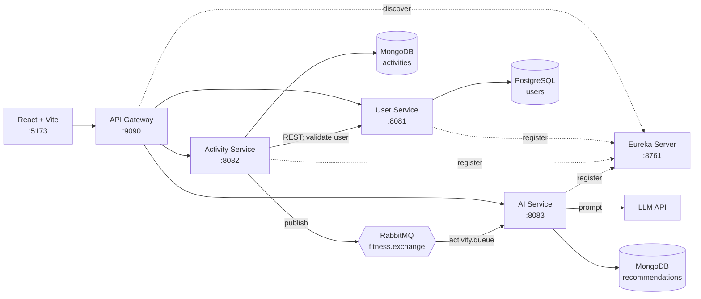
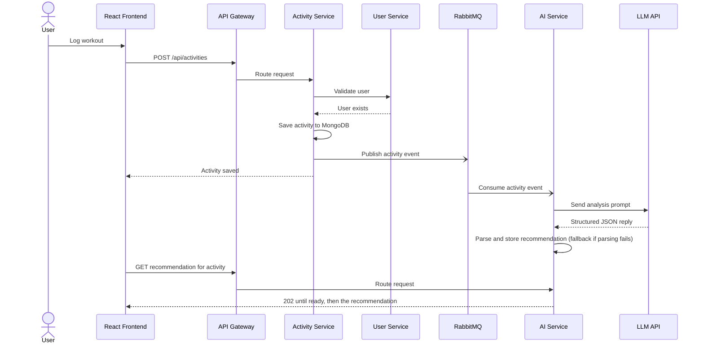

# AI-Powered Fitness Tracker

An event-driven fitness tracking platform built with **Spring Boot microservices** and a **React** frontend. Users log workouts, and an AI service analyzes each activity asynchronously and generates personalized feedback: performance analysis, areas to improve, next-workout suggestions, and safety tips.

## Features
 
- **Activity tracking**: log workouts (running, cycling, swimming, yoga, HIIT, weight training and more) with duration, calories burned, start time, and custom metrics.
- **AI-powered recommendations**: every logged activity triggers an asynchronous AI analysis, so API responses stay fast.
- **Event-driven design**: activity and AI services are decoupled through RabbitMQ.
- **Service discovery and routing**: Eureka registry with a Spring Cloud Gateway as the single entry point.
- **Polyglot persistence**: PostgreSQL for relational user data, MongoDB for flexible activity and recommendation documents.
- **Resilient AI parsing**: falls back to a safe default recommendation if the AI response is malformed or unavailable.
- **Full-Stack Interface**: A React-based frontend for recording activities, viewing activity history, and accessing AI recommendations.

## Architecture
 

 
Solid arrows show request and data flow. Dotted arrows show service registration and discovery through Eureka.



**Flow of a workout:**
1. The frontend posts an activity to the gateway.
2. The **Activity Service** validates the user with the **User Service** (REST call via `WebClient`).
3. The activity is saved to MongoDB and published to RabbitMQ.
4. The **AI Service** consumes the message, prompts an LLM, parses the structured JSON reply, and stores a recommendation in MongoDB.
5. The frontend fetches the recommendation for that activity. The API returns `202 Accepted` until it's ready.

| Service | Port | Responsibility | Datastore |
|---|---|---|---|
| `eureka` | 8761 | Service registry / discovery | n/a |
| `gateway` | 9090 | Routing, CORS, load-balanced entry point | n/a |
| `userservice` | 8081 | User registration, profile, validation | PostgreSQL |
| `activityservice` | 8082 | Activity creation and retrieval, event publishing | MongoDB (`fitnessactivity`) |
| `aiservice` | 8083 | Queue consumer, LLM analysis, recommendations | MongoDB (`fitnessrecommendation`) |
| `fitness-app-frontend` | 5173 | React UI | n/a |

## Tech Stack
 
- **Backend:** Java 17, Spring Boot, Spring Cloud (Gateway, Netflix Eureka), Spring Data JPA / MongoDB, Spring AMQP, WebClient (WebFlux), Lombok, Bean Validation
- **Messaging:** RabbitMQ (direct exchange, durable queue, JSON message converter)
- **Databases:** PostgreSQL, MongoDB
- **AI:** Any OpenAI-compatible chat completions API (e.g., OpenRouter)
- **Frontend:** React 19, Vite, Material UI, React Router, Axios
- **Build:** Maven (wrapper included in each service)
## API Reference
 
All requests go through the gateway at `http://localhost:9090`.
 
### Users
| Method | Endpoint | Description |
|---|---|---|
| POST | `/api/users/register` | Register a new user (email must be unique) |
| GET | `/api/users/{userId}` | Get a user profile |
| GET | `/api/users/{userId}/validate` | Check whether a user exists (used internally by the Activity Service) |
| GET | `/api/users/all` | List all users |
 
### Activities
| Method | Endpoint | Description |
|---|---|---|
| POST | `/api/activities` | Track a new activity (publishes it for AI analysis) |
| GET | `/api/activities` | List activities |
| GET | `/api/activities/{activityId}` | Get one activity |


 
### Recommendations
| Method | Endpoint | Description |
|---|---|---|
| GET | `/api/recommendations/user/{userId}` | All recommendations for a user |
| GET | `/api/recommendations/activity/{activityId}` | Recommendation for an activity (`202` while still processing) |

**Example: track an activity**
```bash
curl -X POST http://localhost:9090/api/activities \
  -H "Content-Type: application/json" \
  -d '{
    "userId": "<user-id>",
    "type": "RUNNING",
    "duration": 30,
    "caloriesBurned": 300,
    "startTime": "2026-10-04T06:30:00Z",
    "additionalMetrics": { "distanceKm": 5 }
  }'
```
 
## Getting Started
 
### Prerequisites
- JDK 17+
- Node.js 20.19+
- PostgreSQL, MongoDB, and RabbitMQ running locally (or hosted instances)
- An API key for an OpenAI-compatible LLM provider
### 1. Clone
```bash
git clone https://github.com/sumits-c/fitness-microservice.git
cd fitness-microservice
```
 
### 2. Configure environment variables
 
| Variable | Used by | Description |
|---|---|---|
| `DB_URL` | userservice | PostgreSQL JDBC URL |
| `MONGODB_ACTIVITY_URI` | activityservice | MongoDB connection string |
| `MONGODB_RECOMMENDATION_URI` | aiservice | MongoDB connection string |
| `RABBITMQ_URL` | activityservice, aiservice | RabbitMQ address |
| `AI_API_URL` | aiservice | Chat completions endpoint |
| `AI_API_KEY` | aiservice | LLM provider API key |
 
> Never commit secrets. `.env` files are already git-ignored.
 
### 3. Start the services (in this order)
```bash
# Terminal 1: service registry
cd eureka && ./mvnw spring-boot:run
 
# Terminal 2-5: each in its own terminal
cd userservice     && ./mvnw spring-boot:run
cd activityservice && ./mvnw spring-boot:run
cd aiservice       && ./mvnw spring-boot:run
cd gateway         && ./mvnw spring-boot:run
```
Eureka dashboard: http://localhost:8761
 
### 4. Start the frontend
```bash
cd fitness-app-frontend
npm install
npm run dev
```
Open http://localhost:5173/activities
 
## Project Structure
 
```
fitness-microservice/
├── eureka/                 # Service discovery server
├── gateway/                # Spring Cloud Gateway (routes + CORS)
├── userservice/            # Users (JPA + PostgreSQL)
├── activityservice/        # Activities (MongoDB) + RabbitMQ producer
├── aiservice/              # RabbitMQ consumer + LLM integration
└── fitness-app-frontend/   # React + Vite + MUI client
```
 
## Key Design Decisions
 
- **Async AI processing:** LLM calls are slow and unreliable, so activity logging never waits on them. The queue decouples the two services and lets the AI service be scaled or restarted independently.
- **Database per service:** user data is relational (unique email, timestamps), while activities carry variable metrics per workout type, which suits MongoDB's document model.
- **Graceful degradation:** if publishing to RabbitMQ fails, the activity is still saved. If the AI response can't be parsed, a safe default recommendation is stored instead of failing.
- **Single entry point:** the gateway resolves services by name through Eureka (`lb://`), so no service URLs are hard-coded in the frontend.

## Author
 
  **Sumit**: [GitHub](https://github.com/sumits-c)

 
